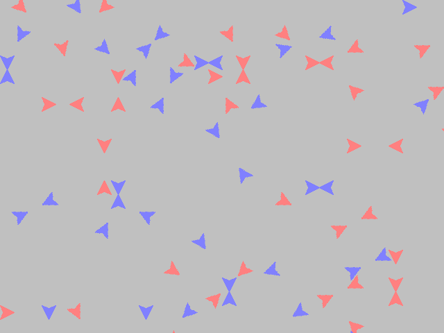

# Circular Array Searching

A C++ DLL for GameMaker that finds the nearest object of a given group on a grid. The room is divided into cells of a fixed size, each cell records one object, and a search walks an offset table that was sorted from the nearest cell outward in advance. With many units on screen, a target can be picked without measuring the distance of every pair. It consists of the DLL, a GameMaker extension package, and a demo that shows it working.

<p>
  
</p>


## How to use

The Releases download contains the GameMaker 8 extension package `cas.gex` and the demo project. Install the extension package and include it in a project to get four functions.

| Function | Action |
|---|---|
| `cas_create(width, height, cellsize)` | Builds the grid and the distance table from the room size and the cell size. Returns 0 if one already exists |
| `cas_update(xprevious, yprevious, x, y, group, id)` | Removes the object from its previous cell and records its group and id in the current cell |
| `cas_search(x, y, id, range, group)` | Returns the id of the nearest `group` object within `range` of that position, or `noone` if there is none |
| `cas_destroy()` | Frees the grid and the table |

Only one structure can exist at a time, and a cell holds one object. A unit in the demo uses it every step like this.

```gml
cas_update(xprevious, yprevious, x, y, group, id)

target = cas_search(x, y, id, range, group)

if target != noone {
  image_angle = point_direction(x, y, target.x, target.y)
}
```

The demo scatters 250 units on a 1000x1000 room with 20 pixel cells and assigns each to the blue or red group at random. Every unit turns toward the nearest unit of its own group, and the view scrolls when the mouse touches the edge of the screen. The source builds by opening `CAS.dev` in wxDev-C++ or with `Makefile.win`.


## How it works

**An offset table sorted by distance is built in advance.** `cas_create` raises the squared distance `i` from 1, finds integer pairs with `j² + u² = i`, and expands each pair through seven symmetry transforms into cell offsets in all eight directions. Offsets at the same distance form a ring, and each ring is preceded by a header entry holding its count and distance. The whole table runs from the shortest ring to the longest, so search order is distance order.

```cpp
for(i=1; i<radius; i++)
{
    for (j=floor(sqrt(i)); j>=0; j--)
    {
        k = i-j*j;
        u = floor(sqrt(k));
        if(u*u == k)
        {
            if(j >= u)
            {
                ...
                buffer->push_back(j);
                buffer->push_back(u);
                Table.push_back(buffer);
                ...
            }
            else{break;}
        }
    }
    ...
}
```

**A search follows the table and stops at the first hit.** `cas_search` takes the cell at the query position, adds each offset from the table in turn, and checks whether that cell holds an object of the requested group. It stops when the distance in a ring header times the cell size reaches `range`. The origin cell is not in the table, so the calling object never matches itself.

**One object per cell.** Each cell of the grid holds just two values, a group and an id. `cas_update` clears the previous cell only if it still belongs to the object, then overwrites the new cell. Since GameMaker exchanges only doubles with a DLL, every argument and return value is a double.


## Files

| Path | Content |
|---|---|
| `source/cpp/cas.cpp`, `source/cpp/export.h` | DLL source |
| `source/cpp/CAS.dev`, `source/cpp/Makefile.win` | wxDev-C++ project and MinGW makefile |
| `source/gex/cas.ged` | GameMaker 8 extension package definition |
| `docs/screenshots/` | Screenshots |
| Releases | Extension package and demo |


## License

zlib. See [LICENSE](LICENSE).
